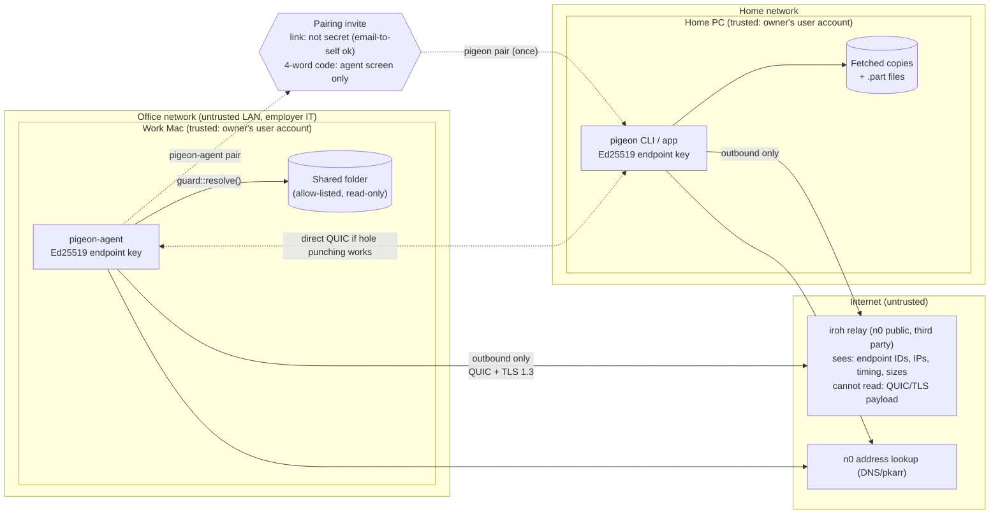

# Pigeon threat model

Owner: Warden. Status: **pre-release, not audited**. Covers the code as of
the week-1 pairing PR: key-based access with an allow-list, pairing per
[PAIRING.md](PAIRING.md) (implemented; deviations in its section 9),
persistent device keys in the OS keystore, connection limits, and (week 2)
one device key per computer for both roles (PAIRING.md D9). The Day-1
bearer ticket is removed. **The repository is treated as public from
2026-11-24** (source, history, PR refs, Actions logs and artifacts readable
by anyone; see [PUBLIC_REPO.md](PUBLIC_REPO.md)). Requirements live in
[REQUIREMENTS.md](REQUIREMENTS.md) (SEC-xx). Update this file whenever the
protocol, auth, storage or relay usage changes.

Pigeon moves files **out of a work computer**. A security mistake here means a
stranger reads someone's work files. That is the worst failure the product can
have, so the default answer to "should a peer get access?" is no.

## 1. System in one picture

**Trust boundaries** (every arrow that crosses one is checked):

| # | Boundary | What crosses it | Check today |
|---|---|---|---|
| B1 | Network peer -> agent | iroh connection, Request; pairing frames while an invite is active | iroh TLS (peer key), allow-list before any stream, connection caps + timeouts, frame caps, path guard; pairing: SPAKE2 + 3 attempts |
| B2 | Agent -> file system | requested path | `guard::resolve` canonicalize + `starts_with(root)` |
| B3 | Agent -> client | Response, file bytes, names, errors | iroh TLS pins the agent key stored at pairing; size/offset checks; SHA-256; `display_safe` |
| B4 | Human channel | invite link (email/chat) and 4-word code (screen, photo) | link has no secret; code is single use, 12 h, 3 attempts, never on the network, and useless offline (PAKE) |
| B5 | Relay / discovery | encrypted packets, endpoint IDs, IPs | iroh end-to-end encryption; relay is untrusted |
| B6 | Build / supply chain | crates, GitHub Actions, binaries | `Cargo.lock --locked`, pinned crate versions, cargo-deny, SHA-pinned actions |
| B7 | Public repo -> CI and `main` | fork PRs, issues, anyone reading history, logs and artifacts | `pull_request` only (no secrets, read-only token for forks), approval for outside contributors' workflows, `check-workflows.sh`, no secret in any artifact, ruleset on `main` (PRs only, no force push / deletion), only the owner can push ([PUBLIC_REPO.md](PUBLIC_REPO.md)) |

## 2. Assets

| Asset | Where | Why it matters |
|---|---|---|
| A1 Work files | Shared folder on the Mac (and everything else on the Mac) | Confidential company data; the main thing to protect |
| A2 Device keys | iroh `SecretKey` per device (one per computer and OS user, shared by `pigeon-agent` and `pigeon`: keystore entry `device-key`, D9; until each pre-D9 pairing is redone, also the old `client-key`, used only to dial the agents paired with it), persistent: macOS login Keychain, Windows Credential Manager (`keystore.rs`); `0600` file only on other OSes or with `PIGEON_KEYSTORE=file` on macOS (refused on Windows) | Whoever holds a paired key *is* that device. Limits (W-9): on Windows any process running as the same user can `CredReadW` the key with no prompt (DPAPI protects it from other users and offline copies, not from malware in the session); on macOS each unsigned rebuild asks for Keychain access again, which teaches users to click "Always Allow" (R11) |
| A3 Pairing secrets | 4-word code of the active invite: shown once on the agent's stdout, kept in the keystore until used/burned/expired (`pair.rs` `Invite`); never sent over the network | Before the owner pairs and before expiry, code + link = one pairing (TH-22). Afterwards: nothing |
| A7 Allow-list | `devices.json` (agent), `agents.json` (client), `spent-invites.json` in the config dir, atomic writes, `devices.json` changes under a lock file (`devices.rs`). Owner-only on every OS: `0700`/`0600` on Unix, a protected user + SYSTEM DACL on Windows (W-3, SEC-29), also when `PIGEON_HOME` is outside the profile | Editing it grants or removes access. Before W-3, another local Windows user could edit it when `PIGEON_HOME` was e.g. under `C:\`; now only the owner (and SYSTEM / admins who can take ownership) can |
| A4 Home copies | Fetched files + `.part` files on the home PC | Same sensitivity as A1, now on a less-managed machine |
| A5 Metadata | File names, sizes, mtimes, endpoint IDs, IP addresses, transfer timing | Leaks what the owner works on and when |
| A6 Build integrity | Source, `Cargo.lock`, CI workflows, release binaries | A backdoored binary bypasses every other control |
| A8 Office login | `/office/` Basic Auth on Cloudflare Pages; hashes only in the Pages project (`OFFICE_USER_SHA256` / `OFFICE_PASS_SHA256`) | Protects the team dashboard (low sensitivity: it shows data that is public in the repo anyway). The **first** login's hashes are in git history and its 4-digit password is **burned** (W-11) |

## 3. Actors

| Actor | Capabilities | Main goal |
|---|---|---|
| T1 Internet attacker | Can reach the agent via relay/discovery if it learns the endpoint ID; can send arbitrary bytes | Read files, crash or exhaust the agent |
| T2 Malicious / compromised relay | Sees and drops/delays all relayed packets, endpoint IDs, IPs | Read or tamper with traffic, MITM a connection, profile users |
| T3 LAN attacker at the office | On-path for direct UDP, can spoof/inject packets, sees DNS | Same as T2 for direct paths; find Pigeon users |
| T4 Stranger with a leaked invite | Has the invite link and maybe the code (chat log, email, screenshot, photo) | Pair as a device and read the share |
| T5 Thief of the home PC / phone | Physical access, maybe unlocked session | Read home copies, reuse the stored device key |
| T6 Malicious agent | Controls everything the agent sends back | Write outside the download folder, overwrite files, fill disk, exploit parser or terminal |
| T7 Supply-chain attacker | Compromises a crate, a GitHub Action or a CI runner | Backdoor binaries, steal CI secrets |
| T8 Curious employer IT | Admin on the Mac and network; DLP, TLS inspection, EDR | Detect/inspect exfiltration; read keys from the Mac |
| T9 Local user / process on the Mac | Write access to the shared folder (e.g. a synced team folder) | Plant symlinks or race the agent to read outside the share |
| T10 Anyone on GitHub | Reads the whole repo, history, PR refs, Actions logs and artifacts; forks; opens PRs and issues; can download a running job's artifacts | Find secrets, take over CI or `main`, slip a change in through a PR that looks like a bot's |

T8 is not an attacker in the legal sense: Pigeon must not try to hide from the
employer. The work Mac belongs to them. We document what they can see and do
not promise secrecy against them (see R9).

## 4. Threats and current mitigations (STRIDE)

Status: **M** mitigated, **P** partial, **O** open. Older rows cite
file:line on the `security-foundation` branch; rows updated in week 1 cite
function and test names instead (line numbers drift).

| ID | STRIDE | Threat | Actor | Mitigation in code | Status |
|---|---|---|---|---|---|
| TH-01 | Spoofing | Peer connects without being allowed | T1 | Deny by default: the peer's iroh-verified endpoint ID must be on the allow-list, checked before any stream is accepted (`Agent::handle`); tests `unpaired_device_is_refused_before_any_stream`, `pairing_with_the_right_code_lists_the_device_and_get_works` | M |
| TH-02 | Spoofing | Leaked ticket = full access, no expiry, no per-device revoke (Warden finding: "a non-expiring password") | T4, T8 | **Ticket removed.** Access = a device key on the allow-list, granted once through pairing (PAIRING.md P1); the link has no secret, the code is single use / 12 h / 3 attempts; `pigeon-agent revoke` per device, closes live connections. Tests: [pairing.rs](../../crates/pigeon-core/tests/pairing.rs) P-T1..P-T8, P-T12 | M |
| TH-03 | Spoofing / Tampering | Relay or LAN MITM | T2, T3 | Client dials the endpoint ID stored at pairing; iroh TLS 1.3 authenticates that key (`client::request`); pairing is bound to the TLS session and both IDs, so a MITM cannot complete it; relay only sees ciphertext | M (relies on iroh) |
| TH-04 | Info disclosure | Path traversal (`..`, absolute, drive, UNC, ADS, NUL) | T1/T4 | `guard.rs:17-41` rejects syntactically; canonicalize + `starts_with` (`guard.rs:43-53`); unit + proof tests + proptest `guard_never_escapes_root` | M |
| TH-05 | Info disclosure | Symlink / junction inside the share points outside | T9 | Canonical path must stay under canonical root (`guard.rs:51`); `list` hides entries whose real path is outside (`agent.rs:128-136`, fixed today); tests `rejects_symlink_escape`, `rejects_junction_escape`, `list_hides_links_that_point_outside_the_share` | M |
| TH-06 | Info disclosure | TOCTOU: component swapped for a symlink between `resolve` and `open` | T9 | None (check and open are separate calls, `agent.rs:165-175`) | O, Low (F9) |
| TH-07 | DoS | Huge frame length / memory exhaustion before auth | T1 | Length checked before allocation (`proto.rs:105`); hello capped at 256 B (`proto.rs:22`); 10 s handshake timeout (`agent.rs:30,72`); proptests on the decoder | M |
| TH-08 | DoS | Many concurrent connections / slow peers; authenticated task waits on `conn.closed()` forever | T1, T4 | `agent::Limits`: 32 connections total (extra ones refused before the QUIC handshake), 4 per peer (closed as busy), 10 s to send the request, 30 s idle timeout on every write and on the final `conn.closed()` wait, connection always closed when the handler ends. Tests: `global_connection_limit_refuses_extra_connections`, `per_peer_connection_limit_closes_extra_connections`, `idle_client_is_disconnected_after_its_request`, `stalled_reader_is_disconnected`. Pairing connections: one per peer, and a peer must send a valid `PairStart` within 3 s before it can take the pairing lock (W-2, see TH-21) | M (F3 fixed) |
| TH-09 | Tampering | Corrupted or mixed file (stale `.part`, changed source) | T6, network | SHA-256 of the whole file checked (`client.rs:168-179`); offset/size checks (`client.rs:207-218`); more-than-announced bytes refused (`client.rs:240`) | M (P if agent sends `sha256: None`, F10) |
| TH-10 | Elevation (client) | Malicious agent picks the local file name / path | T6 | Local name comes from the *user's* PATH argument, sanitized (`pigeon-cli/src/main.rs:72-105`); never overwrites (`client.rs:120-136`) | M |
| TH-11 | Tampering (client) | Terminal escape injection via file names or error text | T6, T9 | `display_safe` (`lib.rs:28`) on names (`pigeon-cli/src/main.rs:114`) and agent errors (`client.rs:106,220`), fixed today | M |
| TH-12 | DoS (client) | Agent announces a huge size and fills the home disk | T6 | None | O, Low (F10) |
| TH-13 | Info disclosure | Secrets in logs | all | The code is printed once on stdout by `pigeon-agent pair` and never logged; `Debug` of `Invite`/`PairingCode`/`Secret` is redacted and `PairingCode` has no `Display`; code-parse errors never echo input; CI masks the code (`cross-network.yml`) | M (log-capture test TODO, SEC-09) |
| TH-14 | Info disclosure | Secret in shell history / process list / clap error echo | T4, T5 | No secret is a CLI argument any more: `ls`/`get` need none, the pairing code comes from `--code-file`, `$PIGEON_PAIR_CODE` or the prompt; only the non-secret invite link is an argument. Tests: `secrets_are_not_command_line_arguments`, `code_is_read_from_a_file_and_never_echoed` | M (F2 fixed) |
| TH-15 | Info disclosure | Error messages reveal the Mac's absolute paths | T4 | Peer-facing errors use only the requested relative path; root error has no path (`guard.rs:46`, fixed today) | M |
| TH-16 | Info disclosure | Home copies readable by other local users | T5 | `.part` created `0600` on Unix (`client.rs:229`, fixed today); Windows inherits the folder ACL | P |
| TH-17 | Info disclosure | Metadata to third parties (n0 relay/discovery: IDs, IPs, timing, volume; the invite link carries the agent ID and relay URL) | T2, T8 | None by design for v1. A tampered link's relay URL is used for the one pairing connection only; the client keeps a relay hint only if it is one of iroh's default n0 relays (W-6, `devices::trusted_relay_hint`, test `only_default_relays_are_kept_as_hints`). **Planned ([RELAY.md](RELAY.md))**: the main metadata holder becomes the Pigeon relay operator (us); n0 still sees pkarr lookups and fallback traffic; relay keeps warn-only logs for 7 days (SEC-36); hints limited to this computer's own relay set (SEC-33) | O, accepted (R9) |
| TH-18 | Tampering | Backdoored dependency / action / binary | T7 | Exact crate pins + `--locked`; `cargo deny` (advisories, licenses, bans, sources) weekly + per PR; actions pinned to SHAs; minimal `permissions:`; gitleaks | P (binaries unsigned) |
| TH-19 | Repudiation | No record of who fetched what | T4 | Agent logs pairings, revokes and refused peers by fingerprint; not every request | O, Low |
| TH-20 | Elevation (Mac) | Agent runs with more rights than needed | T1 | Read-only; only one folder; no listening ports (iroh UDP only; no IPC socket, `pair`/`revoke` talk to `share` through the keystore and the allow-list file); no root needed | M (no sandbox yet) |
| TH-21 | Spoofing | Online guessing of the pairing code; offline guessing from observed traffic | T1, T2, T3, T4 | SPAKE2 bound to the TLS session (exporter) and both endpoint IDs: traffic gives no offline test; 3 attempts per invite (decremented before the PAKE), one handshake at a time, pairing ALPN only while an invite exists, 12 h expiry. Chance per invite <= 3 / 1295^4 ~ 1e-12. Tests: P-T3, P-T4, P-T5, P-T7, P-T10, P-T12. Availability (W-2, fixed): a peer that knows only the agent ID can no longer hold the pairing lock; `PairStart` (with the active invite ID) is read and checked first, within 3 s, and each peer gets one pairing connection (`stranger_without_invite_id_does_not_block_pairing`, `wrong_invite_id_and_second_connection_per_peer_are_refused`). **Accepted residual:** someone who has the *link* can still hold the lock for one handshake (<= 30 s) per attempt and burn the invite's 3 attempts; the owner sees "used up" and makes a new invite | M |
| TH-24 | DoS | A failed attempt on an old invite burns a newer one (W-1) | T4 | `failed_attempt` only counts and clears the invite the handshake belongs to (`stale_failed_attempt_does_not_burn_a_newer_invite`) | M (fixed in review) |
| TH-25 | Spoofing | A used invite comes back after a restart because its keystore delete failed (W-5) | T4 | Spent invite IDs are kept in `spent-invites.json` (not secret) and checked before an invite is activated; an unreadable record fails closed; storage I/O runs outside the invite mutex (`used_invite_does_not_come_back_after_a_restart`, `spent_invites_are_remembered_and_fail_closed`) | M (fixed in review) |
| TH-26 | Tampering | `revoke` and a pairing completing in `share` race on `devices.json` and undo each other (W-4) | owner | Read-modify-write only under `devices.json.lock` (`DeviceList::update`; `concurrent_updates_lose_nothing`) | M (fixed in review) |
| TH-27 | Spoofing / DoS | One-key migration (D9) loses or swaps an identity: two programs create two keys at once, a crash mid-migration deletes the only copy, or an old key is deleted while an agent still needs it, breaking pairings or silently changing the fingerprint | owner, bugs | Create/migrate only under `device-key.lock`, others re-read; device key read back before any delete; old entries deleted only if identical to it or (old client key) no longer referenced; the agent key is kept as the device key so no allow-list changes; fallback to the old client key for agents paired with it; fails closed ("not paired", pair again). Tests: SEC-30 | M |
| TH-28 | DoS | Same endpoint ID online twice on one computer (`pigeon get` next to `pigeon-agent share`): the relay routes the ID to the newest connection, so the share is unreachable through the relay while `get` runs; a publishing client would also replace the agent's address record | owner (self-inflicted), T2 | The fetching side no longer publishes to address lookup (`client::endpoint_builder`; proof: **code review** against iroh 1.5.0 `presets::N0`, no test yet, W-15); `share` holds `share.lock` and `pigeon ls`/`get`/`pair` warn while it is held (W-11, `share_lock_is_visible_and_released`, `warns_only_while_a_share_runs_here`); direct paths unaffected (`both_roles_with_one_key_at_once_over_direct_paths`); TLS still authenticates both ends, so no data goes to anyone else. Relay slot not mitigated (R14) | P |
| TH-22 | Spoofing | Someone who sees link **and** code before the owner pairs pairs first | T4, T8 | Single use: the owner's own attempt then fails with "no active invite" (loud); `pigeon-agent devices` shows the extra device; `revoke` is one command; the agent logs every pairing. OS notification deferred | P (residual by design, PAIRING.md section 6) |
| TH-29 | Info disclosure | Credential material in the public history: the first `/office/` login's SHA-256 hashes (4-digit password, cracked in 6 ms in the audit) | T10 | No defaults in code any more; the gate reads only Cloudflare env vars and fails closed with `503` (`office/middleware.test.mjs`, SEC-31); the old password is burned and must not be reused; the new one is 16+ random characters. gitleaks + manual scan of all refs found no other secret (PUBLIC_REPO.md section 1) | M (W-11) |
| TH-30 | Spoofing | A stranger downloads the running cross-network job's invite artifact and pairs with the CI agent first | T10 | The artifact holds no secret: the code is RSA-OAEP-encrypted to a throwaway key whose private half never leaves the client runner; invite 1 h TTL, single use; both runners are ephemeral and share only random bytes (W-10). Residual: the link lets a stranger burn the 3 attempts and fail the run (CI DoS) | M |
| TH-31 | Tampering / Elevation | A fork PR gets secrets or a write token, or injects into a workflow script; a change reaches `main` without the owner | T10, T7 | Only `pull_request` triggers, top-level minimal `permissions:`, no `github.event.*` in scripts, SHA-pinned actions (all enforced by `check-workflows.sh`, SEC-32); fork-PR workflows wait for approval; ruleset on `main` (PR required, no force push or deletion, required checks); no collaborators besides the owner. Residual: bots use the owner's token, so GitHub cannot stop a bot from merging (process rule) | P (settings apply after the flip) |
| TH-32 | Spoofing (social) | A stranger's fork PR is shown in the office dashboard as a bot's work and in the owner queue as "Review/merge" (PR #12 `build-status.mjs` maps PRs by branch/title) | T10 | Requirement on PR #12: only PRs from this repo by the owner (W-13) | O (PR #12 not merged) |
| TH-23 | Spoofing | Stolen home PC (or its unlocked session, or malware running as the user) reuses its device key | T5 | Key in Windows Credential Manager / macOS Keychain (not a plain file); revoke from the Mac, in-process and through the CLI file path (`revoke_closes_a_live_transfer_within_a_second`, `revoke_through_the_devices_file_closes_a_live_transfer`) | P (an unlocked session or same-user malware can use the key until revoked, A2) |
| TH-33 | DoS / cost | Planned Pigeon relay used as a free open relay by any iroh app (URL is public): egress cost, abuse complaints ([RELAY.md](RELAY.md) 3.2) | T1 | Planned: `shared_token` (public, a speed bump only), per-client rate limit, `accept_conn_limit`, billing alert (SEC-36, SEC-38) | O, design |
| TH-34 | DoS | Pigeon relay down (VPS, cert, provider, DoS): agents homed on it unreachable from UDP-blocked networks | T1, T2 | Planned: agent adds n0 relays at run time when ours is not connected, removes them when it is back (SEC-37); external `/healthz` check | O, design |
| TH-35 | Info disclosure / DoS | Pigeon relay server compromised: attacker gets metadata, can drop/delay, lie in QUIC address discovery; cannot read files or impersonate a device (SEC-21) | T2 | Planned: hardened VM, unprivileged service, pinned iroh-relay `=1.5.0 --locked`, metrics on localhost, nothing valuable stored (SEC-35, SEC-36) | O, design |
| TH-36 | Spoofing (infra) | Relay domain lapses or registrar account is taken: new holder gets a valid cert for the relay name and every shipped binary connects to it (metadata + DoS) | T2 | Planned: multi-year registration, auto-renew, registrar 2FA + lock, CAA, CT monitoring, relay overridable in config ([RELAY.md](RELAY.md) O1) | O, design |
| TH-37 | Info disclosure | User talked into a malicious custom relay; or a link names one | T2, T8 | Planned: custom relay only from local config/CLI, https only, never from links or peers (SEC-33, SEC-34); `pigeon relay` shows it | O, design |

## 5. Open risks, ranked

| Rank | Risk | Severity | Plan |
|---|---|---|---|
| R1 | ~~Bearer ticket: anyone who ever saw it reads the share while the agent runs; no per-device revoke (TH-02)~~ | resolved (week 1) | Pairing per [PAIRING.md](PAIRING.md); ticket removed. Residual: TH-22 |
| R2 | ~~Secret on the command line (TH-14)~~ | resolved (week 1) | No secret in argv; code via file / env / prompt |
| R3 | ~~No connection/concurrency limits; authenticated tasks never time out (TH-08)~~ | resolved (week 1) | `agent::Limits` + tests |
| R11 | macOS Keychain item is in the login keychain without `...ThisDeviceOnly` (needs a signed app, PAIRING.md D2); a Time Machine / migrated keychain carries it to another Mac. Each unsigned rebuild re-prompts for Keychain access, training "Always Allow"; on Windows same-user processes read the key with no prompt (W-9, A2) | Low | Revisit with code signing (R5) |
| R12 | ~~The cross-network CI artifact holds a live invite link + code (W-10)~~ | resolved (2026-11-24) | Code encrypted to a per-run client key; see TH-30. Not yet proven on real runners (Actions blocked by billing until the flip) |
| R15 | Public history keeps the burned office hashes and 14 merge commits with the owner's personal email (W-11, W-12) | Low | Not rewritten (no live secret). Old office password never reused; GitHub email privacy on. Making the repo private again does not remove anything already copied (PUBLIC_REPO.md section 4) |
| R16 | Bots push and open PRs with the owner's GitHub token, so a bot could merge (TH-31) | Low | Process rule (only the owner merges). Later: a separate bot account + one required owner approval |
| R13 | `$PIGEON_PAIR_CODE` stays in the client process environment for the process lifetime, and `spake2` 0.4.0 does not zeroize its password copy / scalar (W-7) | Low (single use, short-lived) | Prefer the prompt or `--code-file`; revisit when spake2 adds zeroize. Removing the env var needs `unsafe` `remove_var` before threads start |
| R14 | One key for both roles (D9): while `pigeon ls`/`get` runs on a computer that also runs `pigeon-agent share`, that share cannot be reached through the relay (newest connection per endpoint ID wins, TH-28). Only relayed paths; direct paths keep working. An in-flight relayed transfer can be dropped by the 30 s idle timeout, and a `share` started during a `get` displaces the `get` | Low (availability, self-inflicted, lasts as long as that command runs: a large relayed `get` can take minutes) | Interim (done): `share.lock` held by `share`, one warning line from `ls`/`get`/`pair` (W-11). **Exit criterion: the app runs both roles in one process on one endpoint**; keep R14 open until then. Only if the CLI stays supported after that: hand requests to a running share over owner-only local IPC (design review by Warden first: changes D5 and SEC-20). A different relay for the CLI does not help (every relay connection registers the ID) |
| R4 | Third-party relay and discovery metadata; employer DLP visibility (TH-17) | Medium (privacy) | Document in README. Relay design in [RELAY.md](RELAY.md): own relay (metadata moves to us, warn-only logs, 7 days) + user-chosen relay; discovery stays on n0 (R19) |
| R17 | n0 public relay is rate-limited (~0.046 MB/s measured on the relay path vs 17-21 MB/s direct); UDP-blocked offices are unusable for large files | Medium (availability) | [RELAY.md](RELAY.md): self-hosted iroh-relay, awaiting owner decision (domain, VPS) |
| R18 | Running our own relay makes us a holder of users' IPs and endpoint IDs (legal requests, GDPR) and an ops target (TH-33..TH-36) | Medium | Keep almost nothing (SEC-36), publish what the relay sees, fallback to n0 (SEC-37) |
| R19 | Address lookup (pkarr/DNS) still on n0: n0 sees which endpoint IDs are looked up and their published relay/addresses; records are signed, so n0 can withhold but not forge | Low | Later: self-host `iroh-dns-server` if users ask |
| R5 | Unsigned binaries from CI artifacts | Medium | Sign + notarize at release (owner approval: Apple Developer) |
| R6 | TOCTOU between guard and open (TH-06) | Low | Anvil: open once, verify the handle's real path, hash and stream from the same handle (or `cap-std`) |
| R7 | Malicious agent can fill disk; `sha256: None` accepted (TH-12, TH-09) | Low | Anvil: require a hash, free-space check, `--max-size` |
| R8 | `.part` follows a pre-existing symlink; `rename` can overwrite on Unix if `out` appears mid-transfer | Low | Anvil: `create_new` for fresh `.part`, no-clobber rename |
| R9 | Pigeon is an exfiltration channel from the employer's view | Policy | Not hidden, not a bypass tool. SECURITY.md scope says so. Users must follow their employer's rules |
| R10 | heapless 0.7 unsound advisories via postcard; chrono unmaintained via iroh | Low | Ignored in `deny.toml` with reason + review date |

## 6. Assumptions

- The owner's user accounts on the Mac and the home PC are not compromised.
  If they are, the attacker already has the files and keys (out of scope).
- iroh 1.5's TLS 1.3 handshake authenticates both endpoints' Ed25519 keys and
  the relay cannot decrypt traffic. We rely on iroh/rustls for this and do not
  re-implement it (no custom crypto).
- The OS RNG (`getrandom`) is sound.
