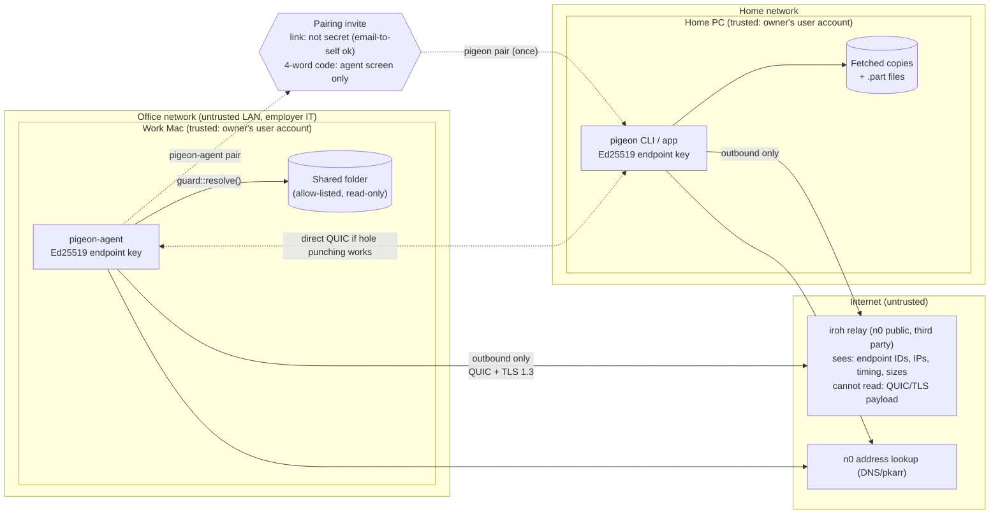

# Pigeon threat model

Owner: Warden. Status: **pre-release, not audited**. Covers the code as of
the week-1 pairing PR: key-based access with an allow-list, pairing per
[PAIRING.md](PAIRING.md) (implemented; deviations in its section 9),
persistent device keys in the OS keystore, connection limits. The Day-1
bearer ticket is removed. Requirements live in
[REQUIREMENTS.md](REQUIREMENTS.md) (SEC-xx). Update this file whenever the
protocol, auth, storage or relay usage changes.

Pigeon moves files **out of a work computer**. A security mistake here means a
stranger reads someone's work files. That is the worst failure the product can
have, so the default answer to "should a peer get access?" is no.

## 1. System in one picture

**Trust boundaries** (every arrow that crosses one is checked):

| # | Boundary | What crosses it | Check today |
|---|---|---|---|
| B1 | Network peer -> agent | iroh connection, Request; pairing frames while an invite is active | iroh TLS (peer key), allow-list before any stream, connection caps + timeouts, frame caps, path guard; pairing: SPAKE2 + 3 attempts |
| B2 | Agent -> file system | requested path | `guard::resolve` canonicalize + `starts_with(root)` |
| B3 | Agent -> client | Response, file bytes, names, errors | iroh TLS pins the agent key stored at pairing; size/offset checks; SHA-256; `display_safe` |
| B4 | Human channel | invite link (email/chat) and 4-word code (screen, photo) | link has no secret; code is single use, 12 h, 3 attempts, never on the network, and useless offline (PAKE) |
| B5 | Relay / discovery | encrypted packets, endpoint IDs, IPs | iroh end-to-end encryption; relay is untrusted |
| B6 | Build / supply chain | crates, GitHub Actions, binaries | `Cargo.lock --locked`, pinned crate versions, cargo-deny, SHA-pinned actions |

## 2. Assets

| Asset | Where | Why it matters |
|---|---|---|
| A1 Work files | Shared folder on the Mac (and everything else on the Mac) | Confidential company data; the main thing to protect |
| A2 Device keys | iroh `SecretKey` per device, persistent: macOS login Keychain, Windows Credential Manager (`keystore.rs`); `0600` file only on other OSes or with `PIGEON_KEYSTORE=file` | Whoever holds a paired key *is* that device |
| A3 Pairing secrets | 4-word code of the active invite: shown once on the agent's stdout, kept in the keystore until used/burned/expired (`pair.rs` `Invite`); never sent over the network | Before the owner pairs and before expiry, code + link = one pairing (TH-22). Afterwards: nothing |
| A7 Allow-list | `devices.json` (agent), `agents.json` (client) in the config dir, owner-only, atomic writes (`devices.rs`) | Editing it grants or removes access; anyone who can already runs as the owner |
| A4 Home copies | Fetched files + `.part` files on the home PC | Same sensitivity as A1, now on a less-managed machine |
| A5 Metadata | File names, sizes, mtimes, endpoint IDs, IP addresses, transfer timing | Leaks what the owner works on and when |
| A6 Build integrity | Source, `Cargo.lock`, CI workflows, release binaries | A backdoored binary bypasses every other control |

## 3. Actors

| Actor | Capabilities | Main goal |
|---|---|---|
| T1 Internet attacker | Can reach the agent via relay/discovery if it learns the endpoint ID; can send arbitrary bytes | Read files, crash or exhaust the agent |
| T2 Malicious / compromised relay | Sees and drops/delays all relayed packets, endpoint IDs, IPs | Read or tamper with traffic, MITM a connection, profile users |
| T3 LAN attacker at the office | On-path for direct UDP, can spoof/inject packets, sees DNS | Same as T2 for direct paths; find Pigeon users |
| T4 Stranger with a leaked invite | Has the invite link and maybe the code (chat log, email, screenshot, photo) | Pair as a device and read the share |
| T5 Thief of the home PC / phone | Physical access, maybe unlocked session | Read home copies, reuse the stored device key |
| T6 Malicious agent | Controls everything the agent sends back | Write outside the download folder, overwrite files, fill disk, exploit parser or terminal |
| T7 Supply-chain attacker | Compromises a crate, a GitHub Action or a CI runner | Backdoor binaries, steal CI secrets |
| T8 Curious employer IT | Admin on the Mac and network; DLP, TLS inspection, EDR | Detect/inspect exfiltration; read keys from the Mac |
| T9 Local user / process on the Mac | Write access to the shared folder (e.g. a synced team folder) | Plant symlinks or race the agent to read outside the share |

T8 is not an attacker in the legal sense: Pigeon must not try to hide from the
employer. The work Mac belongs to them. We document what they can see and do
not promise secrecy against them (see R9).

## 4. Threats and current mitigations (STRIDE)

Status: **M** mitigated, **P** partial, **O** open. Older rows cite
file:line on the `security-foundation` branch; rows updated in week 1 cite
function and test names instead (line numbers drift).

| ID | STRIDE | Threat | Actor | Mitigation in code | Status |
|---|---|---|---|---|---|
| TH-01 | Spoofing | Peer connects without being allowed | T1 | Deny by default: the peer's iroh-verified endpoint ID must be on the allow-list, checked before any stream is accepted (`Agent::handle`); tests `unpaired_device_is_refused_before_any_stream`, `pairing_with_the_right_code_lists_the_device_and_get_works` | M |
| TH-02 | Spoofing | Leaked ticket = full access, no expiry, no per-device revoke (Warden finding: "a non-expiring password") | T4, T8 | **Ticket removed.** Access = a device key on the allow-list, granted once through pairing (PAIRING.md P1); the link has no secret, the code is single use / 12 h / 3 attempts; `pigeon-agent revoke` per device, closes live connections. Tests: [pairing.rs](../../crates/pigeon-core/tests/pairing.rs) P-T1..P-T8, P-T12 | M |
| TH-03 | Spoofing / Tampering | Relay or LAN MITM | T2, T3 | Client dials the endpoint ID stored at pairing; iroh TLS 1.3 authenticates that key (`client::request`); pairing is bound to the TLS session and both IDs, so a MITM cannot complete it; relay only sees ciphertext | M (relies on iroh) |
| TH-04 | Info disclosure | Path traversal (`..`, absolute, drive, UNC, ADS, NUL) | T1/T4 | `guard.rs:17-41` rejects syntactically; canonicalize + `starts_with` (`guard.rs:43-53`); unit + proof tests + proptest `guard_never_escapes_root` | M |
| TH-05 | Info disclosure | Symlink / junction inside the share points outside | T9 | Canonical path must stay under canonical root (`guard.rs:51`); `list` hides entries whose real path is outside (`agent.rs:128-136`, fixed today); tests `rejects_symlink_escape`, `rejects_junction_escape`, `list_hides_links_that_point_outside_the_share` | M |
| TH-06 | Info disclosure | TOCTOU: component swapped for a symlink between `resolve` and `open` | T9 | None (check and open are separate calls, `agent.rs:165-175`) | O, Low (F9) |
| TH-07 | DoS | Huge frame length / memory exhaustion before auth | T1 | Length checked before allocation (`proto.rs:105`); hello capped at 256 B (`proto.rs:22`); 10 s handshake timeout (`agent.rs:30,72`); proptests on the decoder | M |
| TH-08 | DoS | Many concurrent connections / slow peers; authenticated task waits on `conn.closed()` forever | T1, T4 | `agent::Limits`: 32 connections total (extra ones refused before the QUIC handshake), 4 per peer (closed as busy), 10 s to send the request, 30 s idle timeout on every write and on the final `conn.closed()` wait, connection always closed when the handler ends. Tests: `global_connection_limit_refuses_extra_connections`, `per_peer_connection_limit_closes_extra_connections`, `idle_client_is_disconnected_after_its_request`, `stalled_reader_is_disconnected` | M (F3 fixed) |
| TH-09 | Tampering | Corrupted or mixed file (stale `.part`, changed source) | T6, network | SHA-256 of the whole file checked (`client.rs:168-179`); offset/size checks (`client.rs:207-218`); more-than-announced bytes refused (`client.rs:240`) | M (P if agent sends `sha256: None`, F10) |
| TH-10 | Elevation (client) | Malicious agent picks the local file name / path | T6 | Local name comes from the *user's* PATH argument, sanitized (`pigeon-cli/src/main.rs:72-105`); never overwrites (`client.rs:120-136`) | M |
| TH-11 | Tampering (client) | Terminal escape injection via file names or error text | T6, T9 | `display_safe` (`lib.rs:28`) on names (`pigeon-cli/src/main.rs:114`) and agent errors (`client.rs:106,220`), fixed today | M |
| TH-12 | DoS (client) | Agent announces a huge size and fills the home disk | T6 | None | O, Low (F10) |
| TH-13 | Info disclosure | Secrets in logs | all | The code is printed once on stdout by `pigeon-agent pair` and never logged; `Debug` of `Invite`/`PairingCode`/`Secret` is redacted and `PairingCode` has no `Display`; code-parse errors never echo input; CI masks the code (`cross-network.yml`) | M (log-capture test TODO, SEC-09) |
| TH-14 | Info disclosure | Secret in shell history / process list / clap error echo | T4, T5 | No secret is a CLI argument any more: `ls`/`get` need none, the pairing code comes from `--code-file`, `$PIGEON_PAIR_CODE` or the prompt; only the non-secret invite link is an argument. Tests: `secrets_are_not_command_line_arguments`, `code_is_read_from_a_file_and_never_echoed` | M (F2 fixed) |
| TH-15 | Info disclosure | Error messages reveal the Mac's absolute paths | T4 | Peer-facing errors use only the requested relative path; root error has no path (`guard.rs:46`, fixed today) | M |
| TH-16 | Info disclosure | Home copies readable by other local users | T5 | `.part` created `0600` on Unix (`client.rs:229`, fixed today); Windows inherits the folder ACL | P |
| TH-17 | Info disclosure | Metadata to third parties (n0 relay/discovery: IDs, IPs, timing, volume; the invite link carries the agent ID and relay URL) | T2, T8 | None by design for v1 | O, accepted (R9) |
| TH-18 | Tampering | Backdoored dependency / action / binary | T7 | Exact crate pins + `--locked`; `cargo deny` (advisories, licenses, bans, sources) weekly + per PR; actions pinned to SHAs; minimal `permissions:`; gitleaks | P (binaries unsigned) |
| TH-19 | Repudiation | No record of who fetched what | T4 | Agent logs pairings, revokes and refused peers by fingerprint; not every request | O, Low |
| TH-20 | Elevation (Mac) | Agent runs with more rights than needed | T1 | Read-only; only one folder; no listening ports (iroh UDP only; no IPC socket, `pair`/`revoke` talk to `share` through the keystore and the allow-list file); no root needed | M (no sandbox yet) |
| TH-21 | Spoofing | Online guessing of the pairing code; offline guessing from observed traffic | T1, T2, T3, T4 | SPAKE2 bound to the TLS session (exporter) and both endpoint IDs: traffic gives no offline test; 3 attempts per invite (decremented before the PAKE), one handshake at a time, pairing ALPN only while an invite exists, 12 h expiry. Chance per invite <= 3 / 1295^4 ~ 1e-12. Tests: P-T3, P-T4, P-T5, P-T7, P-T10, P-T12 | M |
| TH-22 | Spoofing | Someone who sees link **and** code before the owner pairs pairs first | T4, T8 | Single use: the owner's own attempt then fails with "no active invite" (loud); `pigeon-agent devices` shows the extra device; `revoke` is one command; the agent logs every pairing. OS notification deferred | P (residual by design, PAIRING.md section 6) |
| TH-23 | Spoofing | Stolen home PC (or its unlocked session) reuses its device key | T5 | Key in Windows Credential Manager / macOS Keychain (not a plain file); revoke from the Mac (`revoke_closes_a_live_transfer_within_a_second`) | P (an unlocked session can use the key until revoked) |

## 5. Open risks, ranked

| Rank | Risk | Severity | Plan |
|---|---|---|---|
| R1 | ~~Bearer ticket: anyone who ever saw it reads the share while the agent runs; no per-device revoke (TH-02)~~ | resolved (week 1) | Pairing per [PAIRING.md](PAIRING.md); ticket removed. Residual: TH-22 |
| R2 | ~~Secret on the command line (TH-14)~~ | resolved (week 1) | No secret in argv; code via file / env / prompt |
| R3 | ~~No connection/concurrency limits; authenticated tasks never time out (TH-08)~~ | resolved (week 1) | `agent::Limits` + tests |
| R11 | macOS Keychain item is in the login keychain without `...ThisDeviceOnly` (needs a signed app, PAIRING.md D2); a Time Machine / migrated keychain carries it to another Mac | Low | Revisit with code signing (R5) |
| R4 | Third-party relay and discovery metadata; employer DLP visibility (TH-17) | Medium (privacy) | Document in README; self-hosted relay option later |
| R5 | Unsigned binaries from CI artifacts | Medium | Sign + notarize at release (owner approval: Apple Developer) |
| R6 | TOCTOU between guard and open (TH-06) | Low | Anvil: open once, verify the handle's real path, hash and stream from the same handle (or `cap-std`) |
| R7 | Malicious agent can fill disk; `sha256: None` accepted (TH-12, TH-09) | Low | Anvil: require a hash, free-space check, `--max-size` |
| R8 | `.part` follows a pre-existing symlink; `rename` can overwrite on Unix if `out` appears mid-transfer | Low | Anvil: `create_new` for fresh `.part`, no-clobber rename |
| R9 | Pigeon is an exfiltration channel from the employer's view | Policy | Not hidden, not a bypass tool. SECURITY.md scope says so. Users must follow their employer's rules |
| R10 | heapless 0.7 unsound advisories via postcard; chrono unmaintained via iroh | Low | Ignored in `deny.toml` with reason + review date |

## 6. Assumptions

- The owner's user accounts on the Mac and the home PC are not compromised.
  If they are, the attacker already has the files and keys (out of scope).
- iroh 1.5's TLS 1.3 handshake authenticates both endpoints' Ed25519 keys and
  the relay cannot decrypt traffic. We rely on iroh/rustls for this and do not
  re-implement it (no custom crypto).
- The OS RNG (`getrandom`) is sound.
